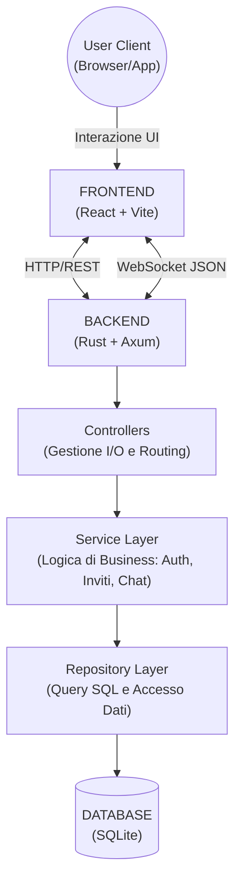
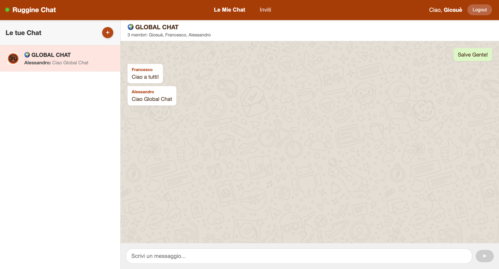

# Ruggine: App di Chat Testuale

**Autori**:
- Alessandro Annecchini
- Riccardo Marconi
- Francesco Palmisani
- Giosuè Pinto


## 1. Introduzione

Il progetto **Ruggine** è un'applicazione di messaggistica istantanea Client/Server sviluppata per il corso di Programmazione di Sistema.
L'obiettivo è fornire una piattaforma performante, scalabile e sicura per lo scambio di messaggi testuali in tempo reale, supportando chat private (DM), gruppi e una chat globale persistente.

L'architettura si basa su un backend in **Rust** (focalizzato su sicurezza e concorrenza) e un frontend in **React** (per una user experience moderna).

### Manuali e Documentazione
All'interno della cartella `manuali/` sono disponibili i documenti di approfondimento:
- **[Manuale del Progettista](manuali/Manuale_del_Progettista.pdf)**
- **[Manuale Utente](manuali/Manuale_Utente.pdf)**

### Presentazione
Nella cartella `presentazione/` sono disponibili le slide illustrative del progetto:
- **[Presentazione Ruggine (PDF)](presentazione/Presentazione%20Ruggine.pdf)**
- **[Presentazione Ruggine (PPTX)](presentazione/Presentazione%20Ruggine.pptx)**


## 2. Architettura del Sistema

Il sistema segue un'architettura a tre livelli (Three-Tier Architecture) con comunicazione ibrida HTTP/WebSocket.


### Tecnologie Utilizzate

**Backend:**
* **Linguaggio:** Rust
* **Framework Web:** Axum (basato su Tokio per l'asincronia)
* **Database:** SQLite (tramite driver SQLx con query asincrone)
* **Sicurezza:** Argon2 (hashing password), JSON Web Token (JWT)
* **Monitoraggio:** Sysinfo (logging CPU)

**Frontend:**
* **Framework:** React
* **Build Tool:** Vite
* **Stato:** React Context API (`WebSocketContext`)
* **Navigazione:** React Router DOM


## 3. Struttura del Progetto

Il progetto è diviso in due macro-componenti principali: il **Backend** (`ruggine_server`) e il **Frontend** (`ruggine_client`).

### Backend (Rust)

Il backend usa una **Layered Architecture** modulare per garantire manutenibilità e separazione delle responsabilità.

**File System (`src/`)**
* `main.rs`: Entry point. Configura il logging, la connessione al DB, avvia il task di monitoraggio CPU e il server HTTP.
* `router.rs`: Definisce le rotte HTTP (`/login`, `/register`) e WebSocket (`/ws`).
* `state.rs`: Gestisce lo stato condiviso in memoria (connessioni attive) thread-safe tramite `Arc<RwLock<...>>`.
* `error.rs`: Gestione centralizzata degli errori con mapping su codici HTTP.

**Moduli Funzionali (`src/`)**
1. **Controllers (`controllers/`)**: Gestiscono l'I/O. Ricevono le richieste (HTTP o WS), validano l'input basilare e chiamano i servizi.
2. **Services (`services/`)**: Contengono la logica di business pura (es. regole inviti, hashing password, cooldown).
3. **Repositories (`repositories/`)**: Eseguono le query SQL pure. Nessuna logica di business qui, solo accesso dati.
4. **DTOs (`DTOs/`)**: Definiscono le strutture dati JSON per la comunicazione Client-Server.

### Frontend (React)

Il client è una Single Page Application (SPA) modulare strutturata in componenti funzionali per favorirne la riusabilità.

**Struttura delle Cartelle (`src/`)**
1. **Components (`components/`)**: Contiene i componenti UI riutilizzabili e indipendenti (es. le singole finestre di chat, la navbar, i form di login).
2. **Pages (`pages/`)**: Rappresentano le viste principali assegnate alle singole rotte dell'applicativo (es. la pagina Home, la pagina degli Inviti).
3. **Context (`context/`)**: Gestisce lo stato globale e persistente dell'applicazione utilizzando le Context API di React (es. `WebSocketContext` per mantenere e gestire la connessione col server ovunque).
4. **Assets (`assets/`)**: Contiene risorse statiche come immagini, icone e file CSS globali.


## 4. Funzionalità Chiave

### Gestione Connessioni e Multi-Device
Il sistema supporta connessioni multiple per lo stesso utente (es. PC e Telefono contemporaneamente).
* **Lato Server:** La struttura in memoria `HashMap<UserId, HashMap<SocketUUID, Sender>>` tiene traccia di ogni tab/dispositivo con un UUID univoco, rimuovendo le singole connessioni senza disconnettere altre sessioni aperte dallo stesso utente.
* **Lato Client (React):** L'applicazione sfrutta la Context API di React (`WebSocketContext`) per erogare una singola connessione WebSocket universale a tutti i componenti della pagina e mantenendo la UI costantemente sincronizzata.

### Protocollo di Comunicazione
La comunicazione tra i livelli sfrutta il passaggio di messaggi JSON fortemente tipizzati garantiti dalle istruzioni di Rust.
* **Client -> Server:** Azioni come log-in (`Auth`), creazione di gruppi (`CreateGroup`), o l'invio di messaggi (`SendGroupMessage`).
* **Server -> Client:** Pushing in tempo reale degli eventi quali `GroupChat`, aggiornamento live degli inviti in arrivo (`UpdateInvitationsList`) o della messaggistica unificata.

### Sistema di Inviti e Cooldown (Logica Avanzata)
Per evitare spam e gestire la privacy, le nuove interazioni richiedono un'accettazione diretta:
1.  **Invito e Notifica (UI Reattiva):** Non appena una richiesta di connessione viene inviata da un utente e posta `pending` nel DB, l'applicazione destinataria React rileva il push dal server e aggiorna automaticamente la sezione dedicata senza bisogno di alcun ricaricamento (Soft Refresh).
2.  **Approvazione/Rifiuto:** L'azione sui bottoni da parte dell'utente aggiorna immediatamente lo stato locale per nascondere o approvare la riga e invia via socket l'handle.
3.  **Cooldown Server-Side:** Rifiutando un invito, il server introduce e verifica temporalmente lo scarto di **2 minuti**, prevenendo lo spam tra i due account via query string.

### Sicurezza e Validazione Form
* **Autenticazione JWT:** L'applicazione è priva di sessioni, e per lo scambio sfrutta token **JWT** firmati. Il front-end non salva mai in cache la password in chiaro, avvalendosi unicamente del token. 
* **WebSocket Auth:** Un client deve manifestare il proprio token subito dopo l'apertura fisica del socket, a prevenzione delle connessioni impiegate ad impersonare altre entità.
* **Password Hashing:** Le credenziali, prima di essere iscritte o lette nel DB, sono derivate utilizzando il moderno schema **Argon2** assieme all'uso dei *salt*.
* **Feedback Istantaneo:** L'applicazione React implementa vincoli espliciti sui campi di Login/Reg intercettando preliminarmente richieste malformate per avvertire fluidamente l'utente.

### Persistenza, Cronologia e Risorse
* **Database Relazionale:** SQLite salva agilmente e persistemente Utenti, Gruppi, Relazioni, Inviti e Messaggi testuali.
* **Ripresa in Tempo Reale:** Al momento del login, il server invia i retroscena della conversazione in cache (ultimi 50 messaggi) che vengono tempestivamente renderizzati a schermo da React e distribuiti assieme al context globale.

### Monitoraggio CPU
Il server avvia un task asincrono (`tokio::spawn`) che utilizza la libreria `sysinfo` per campionare e scrivere nei registri integrati il carico della macchina ogni **2 minuti**.


## 5. Installazione e Guida all'Uso

### Prerequisiti
Per eseguire il progetto in locale, assicurati di avere installato:
* **Rust & Cargo** (per l'ambiente backend)
* **Node.js & npm** (per l'ambiente frontend)

### Avvio
1.  **Backend:**
    ```bash
    cd ruggine_server
    cargo run --release
    ```
    *(Al primo avvio il server creerà automaticamente il DB e applicherà le migrazioni).*

2.  **Frontend:**
    ```bash
    cd ruggine_client
    npm install
    npm run dev
    ```

### Guida all'Uso
1.  **Login/Registrazione:** Interfaccia unificata. Inserire credenziali valide (min 3 caratteri user, min 4 pass).
2.  **Home (Le mie Chat):**
    * A sinistra: Lista delle chat attive e Chat Globale.
    * Pulsante **`+`**: Apre il pannello per creare un nuovo Gruppo o richiedere un DM.
    * A destra: Finestra di chat.
3.  **Inviti:**
    * Accedere alla sezione "Inviti" dalla Navbar.
    * Visualizzare richieste inviate (con stato Pending/Rejected) e ricevute.
    * Accettare o Rifiutare le richieste in arrivo.

### Anteprima dell'Applicazione (Chat Page)

